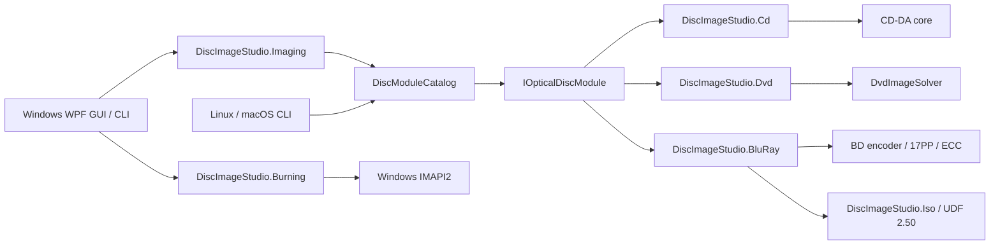

# Architecture

[简体中文](ARCHITECTURE.md) | [繁體中文](ARCHITECTURE.zh-TW.md) | [English](ARCHITECTURE.en.md) | [日本語](ARCHITECTURE.ja.md) | [Türkçe](ARCHITECTURE.tr.md)

## Goals

The central goal is to keep the application shell independent of any single disc encoding. CD, DVD, and Blu-ray differ in physical modulation, error correction, sector organization, and filesystems. They therefore share job lifecycle and product capabilities rather than an inappropriate “universal encoder” base class.

`DiscImageStudio.Cli` and the Windows desktop application execute offline commands through the same module catalog. `DiscImageStudio.ImageIO` uses WIC for the Windows desktop target, and StbImageSharp for reading images and a built-in PNG encoder using .NET `ZLibStream` for writing PNGs on the general `net10.0` target. Both backends supply BGRA pixels to generators in the same order. Blu-ray shares transparency compositing and grayscale conversion code; CD and DVD each also retain their own shared sampling algorithms.

`DiscImageStudio.Localization` is the cross-platform text foundation shared by desktop, CLI, Core, and media modules, providing embedded resources in five languages, language selection, and formatting. The WPF text extension stays in App. Command/option identifiers, serialized fields, and user content do not change with UI language. Only UI culture changes; numeric parsing and project parameters do not. Dynamic UI text follows language switches, while original calibration warnings used for classification are translated at display time. See [LOCALIZATION.md](LOCALIZATION.en.md) for maintenance.

## Core contracts

`DiscImageStudio.Core` references neither WPF, CD, DVD, nor any concrete encoder, and targets `net10.0`.

- `IOpticalDiscModule`: the module execution boundary.
- `DiscModuleDescriptor`: module ID, media family, cancellation capability, and command metadata.
- `DiscCommandDescriptor`: command, capability, and option definitions, available for future dynamic UI generation.
- `DiscJobRequest`: the common command and parameter carrier.
- `DiscJobProgress`: media-independent progress, stage, completed amount, and elapsed time.
- `DiscJobResult`: exit code, summary, and output paths.
- `DiscModuleCatalog`: command routing, duplicate-command checks, and module execution.
- `ToneProfile` / `ToneDither`: the shared CD/DVD/BD tone model (dithering strength, grayscale levels, brightness, sRGB linearization) and deterministic dithering phase. CD/DVD dither at logical byte indices so CD previews can reproduce it after delay interleaving. BD quantizes once at source-image resolution; generation, burning, and preview share the same binary raster.

All three `OpticalDiscFamily` values (`CompactDisc`/`Dvd`/`BluRay`) are implemented. Projects, presets, design, preview, export, burning, and calibration branch according to these three disc types.

Core's common `disc-presets.json` (schema 4) holds disc presets in `cdPresets`, `dvdPresets`, and `bluRayPresets`, each with an independent disabled list. Loading older schema 2/3 files adds built-in BD templates and upgrades on the next save.

## Project model and shell

`DiscImageStudio.Core.ProjectJsonStore` owns `.discproj` (UTF-8 JSON, schemaVersion 2): project name, disc type (CD/DVD/BD), geometry (CD r0/r1/sectors; DVD adds cubic pitch coefficients; BD requires 32-sector alignment, single-layer capacity, and ≤60 mm), layer list, output configuration, optional `tone` section, optional `bluRay` polarity section, calibration-record path, and a thumbnail rendered on save. Missing `tone` means the old hard threshold. SchemaVersion 1 CD/DVD files are written as 2 after loading. BD's `bluRay.invertMapping` exists only in BD projects; CD/DVD files containing it are rejected. Reads and writes validate and use temporary-file atomic replacement under the same rules as preset JSON. Layers reference images by absolute path; assets are not collected.

The shell uses a workspace model: a start page without a sidebar (New/Open, template cards, recent projects) plus five project workspaces—Design / Preview / Export / Burn / Calibration (`Workspace` enum, with sidebar order matching workflow order). These are views of one project rather than independent workflows. They share `DiscParametersState`; `ProjectSession` populates it from a document on open and captures it back on save. Preview, export, burning, and calibration bindings to State are therefore decoupled from project lifecycle. The dirty flag tracks only State properties saved into the project file.

`WindowWorkArea` constrains the main window's custom chrome. In `WM_GETMINMAXINFO`, it sets maximum position/size from the current monitor's physical work area, including taskbars, negative-coordinate monitors, and differing DPI. It recalculates minimum size on monitor, resolution, or DPI changes, rather than relying on the primary-screen system margins in `SystemParameters.WindowResizeBorderThickness`.

Two shell elements expose the workflow: the **stage bar** beneath the `PageHeader` title (`StageBar`: Design → Preview → Export → Burn │ Calibration, with the current stage in brand blue, completed stages subdued with checkmarks, and every stage clickable), and the Next button in the header's right-hand action slot. The window connects both to `NavigateTo`, owns every page instance, and pushes `CurrentWorkspace` to each stage bar on workspace changes. The workflow stays visible and reachable on every page without depending on the sidebar.

Workspace pages share structure and panel design. `MonitorCard` (header icon, title, subtitle, actions, body, optional status footer) hosts previews and the calibration photo stage. `StepCard` (numbered step, Not started/In progress/Complete badge, collapsible body) hosts the calibration page's three-step inspector, expanding the active step and collapsing the others. `VisibilityGate` handles disc-type/mode branches with one boolean, replacing view-specific DataTrigger styles. `PathField` and `SourceChip` consolidate repeated path/source rows; `EmptyStateCard` (icon, one sentence, navigation action) unifies empty-state guidance. Monitor/list containers use the colored `CardHeaderBandStyle` header (MonitorCard and Design layers); form cards retain flat titles. Both use 15px icons. `SourceChip`'s `Actions` slot hosts navigation to the owner, making read-only-summary/navigation rows consistent everywhere. Sidebar/inspector panels use Compact controls (36 px), while the main stage and primary actions use standard height (44 px); both side panels use `SidePanelWidth` (280). Long translated titles, field labels, and calibration action buttons wrap and grow with their content, with action buttons retaining the Compact minimum height.

Every workspace sidebar entry has an icon; collapsing to 72 px turns it into an icon rail, hiding group headings and listing children directly. No second click is needed to expand a folded icon list. A permanent gear/Settings button at the title bar's right (`TitleBar.ShowSettingsButton` + `SettingsRequested`) opens settings from Home and every workspace. A separate button column leaves long project names ellipsized. The “…” menu left of Minimize contains only About (`TitleBar.ShowAppMenu` + `AppMenuRequested`); Ctrl+, also opens settings. Dialogs omit application entry points, and About is no longer at the sidebar bottom.

`DesignView` and `CalibrationView` switch layouts by page width. Wide workspaces are pinned to viewport height, recalculated as the outer `ScrollViewer` viewport/content size changes. Transients such as a zero initial viewport or one-pixel DPI rounding do not leave meaningless scrolling. Narrow layouts move side panels below the stage and scroll the whole page (Design below 900, Calibration below 990). Narrow Design gives the canvas a fixed height so three columns do not squeeze it unusably. Its right panel has naturally sized Properties and Tone cards with its own `ScrollViewer`; below 900 it moves beneath Layers and joins page scrolling. `TonePanel` is a separate UserControl: at 280 px it uses a small disc and one control column; in the full-width folded layout, it shows a larger disc on the left and controls on the right. Its own namescope cannot be crossed by page-level `x:Name`.

`PreviewInspectorViewModel` provides Preview's parameter panel, projecting CD/DVD/BD parameters into the same rows (`ArtifactPath`, `ArtifactLabel`, `MeasuredInnerRadius`, `PreviewSize`, `SamplesPerSector`, …). There is no in-page disc-type switch. Projection follows project type, set by `SetDiscType` on open; the inspector redirects existing rows instead of adding another panel copy. Read-only generation geometry uses text assembled by `DiscParametersState` and navigation to its owner. Artifact readback adds a Deinterleave switch bound directly to shared `CdInterleave`, letting external tracks without sidecars use the user-declared interleaving. BD has no samples-per-sector option. Preview-owned measured radii/pitch and quality write to the displayed disc type under the Measured parameters and preview quality (advanced) expander. BD artifact readback automatically reads its same-named sidecar to restore total sectors, radii, drawing boundaries, polarity, and tone; external ISOs without sidecars still use current project geometry.

Design projection and artifact readback share an 8192×8192 resolution ceiling: CD/DVD 256–8192 px, BD 64–8192 px, clamping out-of-range values. Defaults remain CD 1600, DVD 1200, BD 2048 px. Users can increase quality with Output size (px) in advanced settings. Export preview saves the current PNG rendering and therefore uses this size.

Parameter ownership and progressive disclosure:

- **Generation geometry** (r0, r1, sectors, DVD's three pitch coefficients) is edited only in Project Settings. Other workspaces show a read-only `GeometrySummary` and an Edit shortcut instead of duplicate editors.
- **Disc presets** are shortcuts to the same geometry owner. New Project selects them from the left template list, which contains every non-manual preset in the catalog. Project Settings no longer offers disc-type/preset selection: disc type is fixed by the project. Save parameters as preset at the bottom appends current fields to user preset JSON, with a separate naming confirmation window and immediate catalog refresh.
- **Delivery parameters follow destination**: Export writes files (output path, CUE, interleaving, ISO/data folder/volume label); Burn writes discs (content, recorder, speed). Both consume the same export-quality composite, so the material validated in a file is what reaches the disc. CD/DVD burning type derives from the source's project or calibration-pattern type, without a switch that can select the wrong family. Burn's Content to write segmented control is a page-level source choice, like Preview's Design projection / Output readback. Project composite shows a source summary; calibration pattern links to Calibration. Source selection is no longer nested in a destination switch.
- **Tone** is a generation parameter owned by Design's right panel. Dithering strength (0–100%, 75% for new projects), sRGB linearization (gamma), CD grayscale levels (2/4; DVD/BD fixed at 2), and brightness (±64) are saved in `tone`. Generation, streaming burning, readback, and calibration projection share `ToneProfile`. BD's separate 3T/6T polarity switch is stored in `bluRay.invertMapping`, outside `ToneProfile`. The module's disc preview projects the current composite with the same mapping and updates while sliders move. Export keeps only output options and points to Design for tone; Preview does not edit it again.
- **Preview-only parameters** (measured radii, output size, samples per sector) stay in Preview because they control inspection, not project generation. Measured geometry initially follows project geometry on open, giving a neutral design projection. Differences appear after measured values are entered; only calibration actively rewrites them.

The Design workspace (`DesignViewModel` + `DiscDesignCanvas` + `DesignComposer`) maintains a layer stack stored in panel order (top index 0), with canvas drawing from bottom to top in compositing order. The canvas uses millimeters centered on the disc, supporting dragging, corner scaling, and rotation handles. Selectable layer rows synchronize bidirectionally with canvas and properties. After a 450 ms debounce, `DesignComposer` renders a square composite (preview 2048 px, export 8192 px), centered on the disc with side length 2 × canvas outer radius (CD fixed 57.5 mm; DVD/BD generation outer radius). Its path enters State as the common export/preview source; generation CLI and pipelines need no awareness of composition. Both export and burning use the 8192 px export-quality composite, so preview-validated material is written to disc. Next buttons connect Design → Preview → Export → Burn; Calibration is reached through the sidebar or Burn link.

Design tokens live in `Themes/Tokens.xaml` (colors, semantic colors, radii including `RadiusChip`/`RadiusPanel`/mirrored card-header/footer arcs, control heights, `SidePanelWidth`, page spacing, overlay shadows, canvas palette) and `Themes/Controls.xaml` (typography, button families, inputs, list rows, disclosure panels, `DangerCard`, monitor/step templates). Code animations use the three durations in `Controls/Motion.cs`; custom canvases use `Controls/DiscTheme.cs` and `Controls/DiscRenderCore.cs` for colors and disc drawing instead of separate palettes. Derived implicit styles in `Controls.xaml` (`BasedOn="{StaticResource {x:Type X}}"`) must follow the implicit style: forward references silently fall back to Windows styles rather than reporting an error, producing light system controls. Panels hosting named page content, such as `MonitorCard`, are templated custom controls rather than UserControls. A UserControl isolates content in its own namescope, preventing compilation of page `x:Name` elements and access by snapshot hooks or canvas wiring.

Theme switching is immediate. `Themes/Palette.Light.xaml` overrides every color/brush key from `Tokens.xaml`; `Services/ThemeResolver` inserts or removes this light layer at merged-dictionary index 1 without rebuilding windows. Views must therefore use `DynamicResource` for palette keys: `StaticResource` freezes dark values at load time, which `ThemePaletteTests` rejects. Code-colored controls (`SideNavItem`, `SegmentedControl`, `DiscDesignCanvas`, `CalibrationPhotoCanvas`, `JobDock`, `HelpHint`) subscribe to `ThemeResolver.Changed` and reread tokens. System theme comes from `HKCU\...\Themes\Personalize\AppsUseLightTheme`.

`Services/AppSettingsStore` persists language, theme, default project location, and cache location to `%LOCALAPPDATA%\DiscImageStudio\settings.json` using camelCase, string enums, and atomic temporary-file replacement. Missing, corrupt, or newer-schemaVersion files fall back to defaults; invalid manually edited paths are discarded by `AppSettings.Normalize`. Settings never enter `.discproj`. Default project location affects only New Project's initial directory and falls back to system Documents if absent. `Services/TempFiles` owns the configurable cache (`LivePreviewDirectory`) for composites, thumbnails, and previews. Switching affects only new jobs. Clearing deletes only whitelisted filenames (`design-composite-*`, `design-tone-*`, `design-thumbnail.png`, `cd/dvd/bd-live-*`, and `.png.json` sidecars), never directories, projects, or exports. Settings edits a copy until save; Cancel or Esc discards all edits.

## Image preprocessing layer

`DiscImageStudio.Imaging` sits between UI and media encoders. It holds `RingImageQuality`, the 8192 px production-composite constant shared by composition, export, and streaming burning, and `GrayscaleDither` for the independent dithering tool. The latter processes nominal grayscale palettes with optional sRGB linearization while preserving size and DPI. Image-to-disc layout (scaling, centering, content-ring clipping) is done by Design's `DesignComposer` on the millimeter canvas. Export, burning, and preview consume that composite directly; normal disc generation has no additional preprocessing stage.

## Streaming burning layer

For CD, `OpticalBurnRequest.ProduceContent` explicitly requires headerless 44.1 kHz, 16-bit stereo little-endian PCM; `ContentLength` counts audio only. The generator's default headerless stream retains old big-endian output. The shell selects `CdAudioByteOrder.LittleEndian` explicitly for IMAPI, converting at full-sector output after delay interleaving. File output follows `.wav` / `.raw`: WAV uses the same little-endian audio with a 44-byte RIFF header and matching WAVE CUE; old RAW remains big-endian. The Windows RAW image creator was measured to preserve input bytes unchanged rather than correcting byte order. See [CD burning compatibility](CD_AUDIO_COMPATIBILITY.en.md).

`DiscImageStudio.Burning` owns only Windows IMAPI2 device enumeration, media checks, COM `IStream` adaptation, a bounded 64 MiB memory buffer prefilled to 32 MiB before writing, and burn lifecycle. Automatic speed rereads the current disc's write profiles immediately before CD/DVD writing and chooses the lowest; manual choices stay unchanged. If the device reports no speeds, the burning interface uses a conservative fallback. Generators still own media formats: CD emits 2352-byte audio sectors, DVD's fast algorithm emits 2048-byte data sectors. The burner reads on demand, avoiding a full on-disk image. Existing file-output entry points bypass this layer, preserving their workflow on failure.

DVD hybrid-folder output has two sequential stages. First, scan directories and determine ISO9660/Joliet metadata, file extents, and drawing start/end LBAs. Then emit disc order: metadata → files → pattern for inner placement, metadata → pattern → files for outer placement. Drawing aligns to 16-sector ECC Blocks. Plans store only metadata, not file content, and support non-seekable streams.

BD-R reuses the same burning contract. `BluRayIsoGenerator` writes UDF 2.50, pattern, and trailing backup metadata in one forward stream. Outer placement moves the complete file partition before the backup area, with drawing always 32-sector aligned and excluded from the virtual metadata map. Burn feeds it directly into MMC sequential writing without saving a full 25 GB image. BD provides no spare-area remapping; interrupted discs usually cannot resume writing.

`ProjectOutputs.FilesAtOuterRing` is optional and defaults to `false`. DVD/BD synchronize export, preview, and burning through shared parameter state. GUI previews show the file area in yellow using drawing boundaries, including required filesystem reservations; the color does not enter generators. Existing artifacts rely on fixed sidecar ranges, without guessing layout again from the current directory.

## Module boundaries

### CD

`DiscImageStudio.Cd` owns CD geometry, image sampling, RAW output, and delay interleaving. It implements cancellation and converts byte progress to common `DiscJobProgress`.

### DVD

`DiscImageStudio.Dvd` is a thin adapter for metadata, routing, and result normalization, calling the isolated `DvdImageSolver`. Original engine parameters and selftests stay unchanged.

### Blu-ray

`DiscImageStudio.BluRay` owns BD geometry, 17PP, EDC/Reed-Solomon/LDC-BIS, 3T/6T run-count mapping, streaming generation, and ISO planning. It references `DiscImageStudio.Iso` for UDF 2.50, exposes jobs to GUI only through Core contracts, and neither references nor modifies CD/DVD internals. BD quantizes `ToneProfile` at source resolution; `BluRayRunLengthMapping` only handles threshold 128 and polarity inversion. Generation writes a `bd-r-image-v1` sidecar beside the ISO with sectors, radii, drawing boundaries, polarity, tone, and UDF timestamp.

## Extension rules

1. Module IDs and command names must be globally unique; the catalog rejects conflicts at startup.
2. Modules must not read GUI-control state. All input comes from `DiscJobRequest`.
3. Modules must not open windows directly. Logs, progress, and results return through contracts.
4. If an algorithm cannot cancel safely, `SupportsCancellation` must be `false`.
5. Media-specific formats stay in their own modules; only stable, truly shared concepts enter Core.
6. New modules need catalog-routing tests and a minimal output smoke test.

## Build inputs and CI

The build toolchain pins SDK `10.0.403` through `global.json` and uses runtime `10.0.14`. CI runs `packaging/Install-DotNetSdk.py` with the five official platform archive URLs and SHA512 values in `eng/dependencies/dotnet-sdk.json`, verifies the complete download before extraction, and installs into a fresh directory; it does not reuse an existing SDK by version. SDK upgrades require reviewing the version, archive hashes, and dependency locks together.

CI pins CPython `3.14.10` through `.python-version`, and Python tools use reviewed wheels from `requirements-ci.lock`. Actions pin commits, and build provenance uses `actions/attest` `4.2.2`; attestations and locks do not replace code review or repair every bundled dependency vulnerability. See the [security policy](../SECURITY.en.md) for remaining Python Pillow/Brotli and Actions advisory boundaries.
