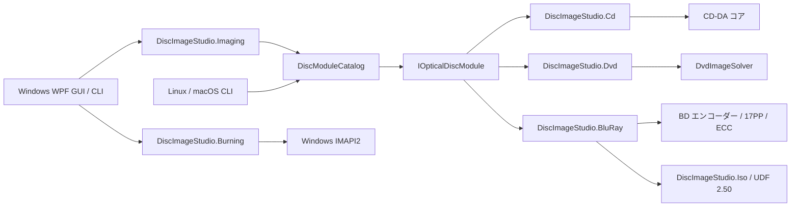

# アーキテクチャ

[简体中文](ARCHITECTURE.md) | [繁體中文](ARCHITECTURE.zh-TW.md) | [English](ARCHITECTURE.en.md) | [日本語](ARCHITECTURE.ja.md) | [Türkçe](ARCHITECTURE.tr.md)

## 目的

アプリケーションの外側の仕組みを特定のディスク符号化に依存させないことが中心的な目的です。CD、DVD、Blu-ray では物理変調、誤り訂正、セクター構成、ファイルシステムが異なります。そのため、共有するのはジョブのライフサイクルと製品の機能であり、不適切な「万能エンコーダー」基底クラスではありません。

`DiscImageStudio.Cli` と Windows デスクトップアプリは、同じモジュールカタログからオフラインコマンドを実行します。`DiscImageStudio.ImageIO` は Windows デスクトップターゲットでは WIC を使い、汎用の `net10.0` ターゲットでは StbImageSharp で画像を読み、.NET の `ZLibStream` を使う内蔵 PNG エンコーダーで書き出します。どちらのバックエンドも同じ順序の BGRA ピクセルを生成器に渡します。Blu-ray はアルファ合成とグレースケール変換のコードを共有し、CD と DVD もそれぞれ既存のサンプリングアルゴリズムを共有します。

`DiscImageStudio.Localization` はデスクトップ、CLI、Core、メディアモジュールで共有するクロスプラットフォームのテキスト基盤で、5 言語の埋め込みリソース、言語選択、書式設定を提供します。WPF のテキスト拡張は App に残し、コマンドやオプションの識別子、シリアライズするフィールド、ユーザーの内容は UI 言語で変更しません。切り替えるのは UI culture のみで、数値の解析やプロジェクトのパラメーターには影響しません。動的な UI テキストも言語切り替えに追従し、分類に使う元のキャリブレーション警告は表示時に翻訳します。保守手順は [LOCALIZATION.md](LOCALIZATION.ja.md) を参照してください。

## Core の契約

`DiscImageStudio.Core` は WPF、CD、DVD、具体的なエンコーダーを参照せず、`net10.0` をターゲットとします。

- `IOpticalDiscModule`：モジュール実行の境界。
- `DiscModuleDescriptor`：モジュール ID、メディアファミリー、キャンセル対応、コマンドのメタデータ。
- `DiscCommandDescriptor`：コマンド、機能、オプションの定義。将来の動的な UI 生成にも利用できます。
- `DiscJobRequest`：共通のコマンドとパラメーターの入れ物。
- `DiscJobProgress`：メディアに依存しない進捗、段階、完了量、経過時間。
- `DiscJobResult`：終了コード、要約、出力パス。
- `DiscModuleCatalog`：コマンドの振り分け、重複コマンドの検査、モジュールの実行。
- `ToneProfile` / `ToneDither`：CD/DVD/BD で共通の階調モデル（ディザ強度、階調数、明るさ、sRGB 線形化）と決定的なディザ位相。CD/DVD は論理バイトインデックス上でディザ処理するため、CD の遅延インターリーブ後もプレビューで再現できます。BD は元画像の解像度で一度だけ量子化し、生成、書き込み、プレビューで同じ 2 値ラスターを共有します。

`OpticalDiscFamily` の 3 つの値（`CompactDisc`/`Dvd`/`BluRay`）はすべて実装済みです。プロジェクト、プリセット、デザイン、プレビュー、エクスポート、書き込み、キャリブレーションはこの 3 種類で分岐します。

ディスクプリセットは Core 共通の `disc-presets.json`（schema 4）に保存します。`cdPresets`、`dvdPresets`、`bluRayPresets` の 3 グループがあり、それぞれ独立した無効化リストを持ちます。schema 2/3 の旧ファイルを読むときは組み込み BD テンプレートを補い、次の保存でアップグレードします。

## プロジェクトモデルとアプリケーションシェル

`DiscImageStudio.Core.ProjectJsonStore` は `.discproj`（UTF-8 JSON、schemaVersion 2）を扱います。内容はプロジェクト名、ディスク種別（CD/DVD/BD）、幾何パラメーター（CD は r0/r1/セクター、DVD はさらに 3 次トラックピッチ係数、BD は 32 セクター境界、単層容量、≤60 mm を要求）、レイヤー一覧、出力設定、任意の `tone` 階調節、任意の `bluRay` 極性節、キャリブレーション記録のパス、保存時に描画したサムネイルです。`tone` の省略は旧来の固定しきい値を意味し、schemaVersion 1 の CD/DVD ファイルは読み込み後に自動的に 2 として書き戻します。BD の `bluRay.invertMapping` は BD プロジェクトだけに存在し、CD/DVD にこの節があると拒否します。読み書きの両方で検証し、一時ファイルによるアトミックな置換を行います。規則はプリセット JSON と同じです。レイヤーは画像を絶対パスで参照し、リソースを収集しません。

シェルはワークスペースモデルです。スタートページ（サイドバーなし。新規作成/開く、テンプレートカード、最近のプロジェクト）と、デザイン / プレビュー / エクスポート / 書き込み / キャリブレーションの 5 つのプロジェクトワークスペースからなります（`Workspace` 列挙。サイドバーの順序が作業の順序）。各ワークスペースは同じプロジェクトの別の見方であり、独立した一連の処理ではありません。1 つの `DiscParametersState` を共有し、開くときに `ProjectSession` がドキュメントの内容を設定し、保存時に再び取り込みます。そのため、プレビュー、エクスポート、書き込み、キャリブレーションの State バインディングはプロジェクトのライフサイクルから完全に分離されています。変更済みフラグはプロジェクトファイルに書き込む State プロパティだけを追跡します。

メインウィンドウ独自の chrome は `WindowWorkArea` で制約します。`WM_GETMINMAXINFO` で現在のモニターの物理的な作業領域（タスクバー、負座標のモニター、異なる DPI を含む）に基づいて最大位置とサイズを設定し、モニター間の移動、解像度、DPI の変更時に最小サイズを再計算します。`SystemParameters.WindowResizeBorderThickness` の主モニター用システム余白には依存しません。

作業の流れはシェルの 2 つの仕組みで常に確認できます。ページヘッダー（`PageHeader`）のタイトル行の下にある**段階バー**（`StageBar`。デザイン → プレビュー → エクスポート → 書き込み │ キャリブレーション。現在の段階はブランドの青で強調し、通過済みの段階はチェック付きで控えめに表示。どの段階にもクリックで移動可能）と、ヘッダー右スロットの「次へ」ボタンです。どちらもウィンドウから `NavigateTo` に接続します。ウィンドウはすべてのページインスタンスを保持し、ワークスペース変更時に各ページの段階バーへ `CurrentWorkspace` を渡します。これにより、どのページでもサイドバーに依存せず流れを確認し、移動できます。

ワークスペースページの骨組みとパネルの表現は共通です。`MonitorCard`（ヘッダーのアイコン + タイトル + サブタイトル + 操作スロット、本文、任意の下部ステータスバー）はプレビュー結果とキャリブレーション写真のステージを表示します。`StepCard`（番号付きステップカード。未開始/進行中/完了の状態バッジ + 折りたたみ可能な本文）はキャリブレーションページの 3 段階のインスペクターを表示し、現在の段階を展開、ほかを折りたたみます。`VisibilityGate`（真偽値で内容の表示を切り替え）は各ページのディスク種別/モード分岐を統一し、各ビュー固有の DataTrigger スタイルを置き換えます。`PathField` と `SourceChip` は繰り返し現れるパス行と入力元バーを単一の実装にまとめます。`EmptyStateCard`（アイコン + 1 文 + 移動操作）は空の状態の案内を統一します。カードヘッダーは 2 種類です。モニター/リストのコンテナーは `CardHeaderBandStyle` の帯状ヘッダー（MonitorCard、デザインページのレイヤーカード）、フォームカードは平面的なタイトルを使い、アイコンはいずれも 15px です。`SourceChip` の `Actions` スロットに「編集元へ移動」ボタンを置くため、「読み取り専用の要約 + 移動」行は全ページで同じ外観です。密度の規則：サイドバー/インスペクターパネルは Compact 系（36 px）、メインステージと主操作ボタンは標準高（44 px）、左右のパネル幅は共通の `SidePanelWidth`（280）トークンを使います。翻訳で長くなるタイトル、フィールドラベル、キャリブレーション操作ボタンは折り返して内容に応じて高くなり、操作ボタンは Compact の最小高を保ちます。

サイドバーの各ワークスペース項目にはアイコンがあり、72 px に縮めるとアイコンバーになります（狭い状態ではグループ見出しを隠し、子項目を直接表示）。もう一度クリックしないと展開しない折りたたみアイコン一覧はありません。タイトルバー右側には常設の「歯車 + 設定」ボタン（`TitleBar.ShowSettingsButton` + `SettingsRequested`）があり、ホームと全ワークスペースから 1 回の操作で設定を開けます。タイトルバーには独立したボタン列を確保し、長いプロジェクト名は自動で省略します。最小化ボタンの左の「…」アプリメニューには「このアプリについて…」だけを置きます（`TitleBar.ShowAppMenu` + `AppMenuRequested`）。Ctrl+, でも設定を直接開けます。ダイアログにアプリへの入口は表示せず、サイドバー下部にも「このアプリについて」を残しません。

`DesignView` と `CalibrationView` はページ幅でレイアウトを切り替えます。広いウィンドウではワークスペースをビューポートの高さに固定します（外側の `ScrollViewer` のビューポート/コンテンツサイズの変化に応じて固定値を再計算するため、初回レイアウトでビューポートがゼロ、DPI 丸めで 1 ピクセルずれるといった過渡状態でも、意味のないスクロール状態が残りません）。狭いウィンドウではサイドパネルをステージの下に移し、ページ全体をスクロールします（デザインページはページ幅 < 900、キャリブレーションページは < 990）。デザインページの狭いレイアウトではキャンバスに固定高を与え、3 列が詰まってキャンバスが使えないほど小さくなることを防ぎます。右列は自然な高さの「プロパティ + 階調」の 2 カードで、右列自身の `ScrollViewer` でスクロールします。ページ幅 < 900 ではレイヤーカードの下へ移し、ページ全体と一緒にスクロールします。階調モジュール（`TonePanel`）は独立した UserControl で、280 px の右列では小さなディスク面と 1 列の操作部、折り返した全幅の右列では左に大きなディスク面、右に操作部を配置します（独自の名前スコープを持ち、ページの `x:Name` はその境界を越えられません）。

プレビューページのパラメーターパネルは `PreviewInspectorViewModel` が提供します。CD、DVD、BD の 3 組のパラメーターを同じ行群（`ArtifactPath`、`ArtifactLabel`、`MeasuredInnerRadius`、`PreviewSize`、`SamplesPerSector` …）へ投影します。ページ内にディスク種別の切り替えはなく、投影プレビューはプロジェクトの種別に厳密に従います。開くときに `SetDiscType` で指定し、インスペクターは同じ行群の参照先を現在の種別へ変えるだけで、パネルの別コピーには入れ替えません。読み取り専用グループ（生成時の幾何）は `DiscParametersState` が組み立てた説明を表示し、編集元へ移動できます。生成物の読み戻しモードでは共有の `CdInterleave` に直接バインドした「逆インターリーブ」スイッチも提供し、sidecar のない外部音声トラックをユーザーが指定するインターリーブ方式で読み戻せます。BD にセクターあたりのサンプル数はありません。プレビュー独自のグループ（実測半径とトラックピッチ、プレビュー精度）への書き込みは現在表示中の種別に反映し、「実測パラメーターとプレビュー精度（詳細）」エキスパンダーに収めます。BD の読み戻しは同名 sidecar を自動で読み、総セクター数、半径、描画開始/終了、極性、階調を復元します。sidecar のない外部 ISO は現在のプロジェクトの幾何で読み戻します。

デザイン投影と生成物の読み戻しは 8192×8192 の解像度上限を共有します。CD/DVD は 256–8192 px、BD は 64–8192 px で、範囲外では境界値で描画します。既定サイズは引き続き CD 1600、DVD 1200、BD 2048 px です。詳細パラメーターの「エクスポートサイズ (px)」で精度を上げられます。「プレビューをエクスポート」は現在描画した PNG を保存するため、このサイズを引き継ぎます。

パラメーターの管理場所と段階的な情報開示：

- **生成時の幾何**（r0、r1、セクター、DVD の 3 項のトラックピッチ）はプロジェクト設定ダイアログだけで編集します。他のワークスペースは読み取り専用の要約（`GeometrySummary`）と直接移動する「編集…」ボタンを表示し、別のエディターを提供しません。
- **ディスクプリセット**は生成時の幾何への近道で、同じ場所に属します。新規プロジェクトでは左のテンプレート一覧から選びます（カタログ内の手動以外の全プリセットを表示）。プロジェクト設定ダイアログにはディスク種別とプリセットの選択を表示しません。ディスク種別はプロジェクトで固定し、パラメーター欄の下部に「このパラメーターをプリセットとして保存」を置いて、現在のフィールドをユーザープリセット JSON に追加します（独立したウィンドウで名前を確認し、保存後すぐカタログを更新）。
- **出力先ごとに出力パラメーターを分離**します。エクスポートワークスペースはファイル出力（出力パス、CUE、インターリーブ、ISO/データフォルダー/ボリュームラベル）だけを、書き込みワークスペースはディスクへの書き込み（書き込む内容、ドライブ、速度）だけを扱います。どちらも同じエクスポート品質の合成画像を使うため、ファイルで検証した素材がディスクにも書かれます。書き込みの CD/DVD 種別は入力元（プロジェクトの種別またはキャリブレーションパターンの種別）から導き、誤った側へ切り替えるスイッチはありません。「書き込む内容」のセグメントコントロールはページ全体の入力元選択です（プレビューページの「デザイン投影 / 生成物の読み戻し」と同じ方式）。プロジェクト合成画像なら入力元の要約を直接表示し、補助キャリブレーションパターンならキャリブレーションワークスペースへリンクします。入力元の選択を出力先スイッチの内部に入れません。
- **階調**は生成パラメーターで、デザインワークスペースの右列に属します。ディザ強度（0–100%、新規プロジェクトは 75%）、sRGB 線形化（ガンマ）、CD の階調数（2/4 階調。DVD/BD は 2 階調固定）、明るさ（±64）をプロジェクトの `tone` 節に書き込みます。生成、ストリーミング書き込み、読み戻し、キャリブレーション投影は同じ `ToneProfile` を使います。BD は別に 3T/6T 極性スイッチを持ち、データ上は独立した `bluRay.invertMapping` として `ToneProfile` には入れません。モジュール内のディスク面プレビューは同じマッピングで現在の合成画像を投影し、スライダー操作ですぐ更新します。エクスポートページには出力オプションと階調の編集場所の案内だけを残し、プレビューページにも重複した編集機能を置きません。
- **プレビュー専用パラメーター**（実測半径、エクスポートサイズ、セクターあたりのサンプル数）は、プロジェクトのパラメーターではなく検査の操作なので、プレビューページに置きます。プロジェクトを開くときは実測幾何をプロジェクト幾何に合わせ、デザイン投影を既定で中立にします。実測値を入力した後に両者のずれを表示し、これらを能動的に書き換えるのはキャリブレーションフローだけです。

デザインワークスペース（`DesignViewModel` + `DiscDesignCanvas` + `DesignComposer`）はレイヤースタックを管理します。レイヤーはパネル順（最上部がインデックス 0）で保存し、キャンバスは合成順と同じく下から上に描画します。ディスク中心を原点とする mm 座標で描画し、ドラッグ/角での拡縮/回転ハンドルを提供します。レイヤー行は選択可能なリストで、キャンバスとプロパティパネルに双方向同期します。レイヤー編集後は 450 ms のデバウンスを経て `DesignComposer` が正方形の合成画像（プレビュー 2048 px、エクスポート 8192 px）を描画します。正方形の中心がディスク中心、辺長が 2 × キャンバス外半径（CD は 57.5 mm 固定、DVD/BD は生成時の外半径）です。合成画像を State の入力画像パスに設定し、エクスポートとプレビューの共通入力とします。生成 CLI とパイプラインはこの仕組みを意識しません。エクスポートと書き込みはどちらもエクスポート品質の 8192 px 合成画像を使うため、プレビューで検証した素材がディスクへ書き込まれます。ヘッダーの「次へ」はデザイン → プレビュー → エクスポート → 書き込みをつなぎ、キャリブレーションはサイドバーまたは書き込みページのリンクから開きます。

デザイン言語は `Themes/Tokens.xaml`（色、意味に応じた色、角丸。`RadiusChip`/`RadiusPanel`/カード上下の対称カーブ、コントロール高、`SidePanelWidth`、ページ余白、オーバーレイの影、キャンバスのパレットを含む）と `Themes/Controls.xaml`（文字の階層、ボタン群、入力コントロール、リスト行、開閉パネル、`DangerCard` 警告カード、モニター/ステップカードのテンプレート）に集約します。コード側のアニメーションは `Controls/Motion.cs` の 3 種類の時間を使い、独自キャンバスは `Controls/DiscTheme.cs` と `Controls/DiscRenderCore.cs` から色を取得してディスクを描き、別々のパレットを持ちません。`Controls.xaml` 内で暗黙のスタイルから派生するスタイル（`BasedOn="{StaticResource {x:Type X}}"`）は、その暗黙のスタイルより後に置く必要があります。前方参照はエラーにならず Windows の組み込みスタイルへ静かにフォールバックし、明るいシステム外観で表示されます。ページの名前付きコンテンツを収めるパネル（`MonitorCard` など）は、UserControl ではなくテンプレート化したカスタムコントロールにします。UserControl は内容を独自の名前スコープに隔離するため、ページ内の `x:Name` 要素をコンパイルできず、スナップショットフックやキャンバスの接続からもアクセスできません。

テーマは即座に切り替わります。`Themes/Palette.Light.xaml` は `Tokens.xaml` の全色/ブラシキーを上書きし、`Services/ThemeResolver` がマージ済みディクショナリのインデックス 1 に明るいテーマ層を挿入/削除するため、ウィンドウの再作成は不要です。そのため、ビューのパレットキーは `DynamicResource` を使う必要があります（`StaticResource` は読み込み時の暗い値を固定し、`ThemePaletteTests` が検出します）。コードから色を取得するコントロール（`SideNavItem`、`SegmentedControl`、`DiscDesignCanvas`、`CalibrationPhotoCanvas`、`JobDock`、`HelpHint`）は `ThemeResolver.Changed` を購読してトークンを読み直します。システムテーマは `HKCU\...\Themes\Personalize\AppsUseLightTheme` から取得します。

アプリ設定は `Services/AppSettingsStore` が `%LOCALAPPDATA%\DiscImageStudio\settings.json` に永続化します（camelCase、文字列の列挙値、一時ファイルによるアトミックな置換）。内容は言語、テーマ、プロジェクトの既定保存先、キャッシュ場所です。ファイルがない、破損している、schemaVersion が現在より高い場合は既定値へ戻し、手動編集で不正になったパスは `AppSettings.Normalize` で除きます。設定は `.discproj` に書き込みません。プロジェクトの既定保存先は新規プロジェクトダイアログの初期フォルダーだけに影響し、存在しなければシステムのドキュメントフォルダーへ戻ります。`Services/TempFiles` は設定可能なキャッシュディレクトリ（`LivePreviewDirectory`）を持ち、デザイン合成画像、サムネイル、プレビュー画像をそこへ書き込みます。場所の変更は新しいジョブだけに適用します。キャッシュの消去はファイル名の許可リスト（`design-composite-*`、`design-tone-*`、`design-thumbnail.png`、`cd/dvd/bd-live-*` とその `.png.json` sidecar）で削除し、ディレクトリ、プロジェクト、エクスポートファイルは削除しません。設定ウィンドウでは保存するまでコピーだけを変更し、キャンセルまたは Esc ですべての編集を破棄します。

## 画像前処理層

`DiscImageStudio.Imaging` は UI とメディア符号化モジュールの間にあり、`RingImageQuality` を提供します。これはデザイン合成画像の正式生成サイズ（8192 px）の定数で、デザイン合成、エクスポート、ストリーミング書き込みで共有します。また、独立したディザツール用の `GrayscaleDither` も提供し、公称グレースケールパレットで画像を処理し、任意の sRGB 線形化を行い、サイズと DPI を保ちます。画像のディスク面への配置（拡縮、中央配置、内容領域の環への切り抜き）はデザインページの `DesignComposer` が mm キャンバス上で行い、エクスポート/書き込み/プレビューは合成結果をそのまま使います。通常のディスク面生成には別の前処理を設けません。

## ストリーミング書き込み層

CD の `OpticalBurnRequest.ProduceContent` は、ヘッダーなしの 44.1 kHz、16 ビット、ステレオ、リトルエンディアン PCM を明示的に要求し、`ContentLength` は音声データだけを数えます。CD 生成器の既定のヘッダーなしストリームは旧来のビッグエンディアン出力を保ち、IMAPI を呼ぶときにシェルが `CdAudioByteOrder.LittleEndian` を明示します。変換は遅延インターリーブ完了後のセクター全体の出力時に行います。ファイル生成は `.wav` / `.raw` 拡張子で形式を選びます。WAV は同じリトルエンディアン音声データに 44 バイトの RIFF ヘッダーと同名の WAVE CUE を追加し、旧 RAW はビッグエンディアンを保ちます。Windows RAW イメージビルダーは、実測で渡されたバイトをそのまま保ち、バイト順を修正しません。詳しくは [CD 書き込み互換性](CD_AUDIO_COMPATIBILITY.ja.md) を参照してください。

`DiscImageStudio.Burning` は Windows IMAPI2 のデバイス列挙、メディア検査、COM `IStream` アダプター、64 MiB の上限付きメモリバッファー（書き込み前に 32 MiB を充填）、書き込みライフサイクルだけを担当します。自動速度は CD/DVD の書き込みを実際に開始する際に現在のディスクの書き込み設定を再取得し、最低値を選びます。手動選択は元の値を保ち、デバイスが速度を報告しない場合は書き込みインターフェイスの保守的なフォールバックを使います。メディア形式は引き続き CD/DVD 生成器が管理し、CD は 2352 バイトの音声セクター、DVD 高速アルゴリズムは 2048 バイトのデータセクターを順に生成します。書き込み側が必要に応じてブロックを読むため、完全なイメージをディスク上に作りません。既存のファイル出力入口はこの層を通らず、失敗しても従来のワークフローを壊しません。

DVD の混合フォルダーモードは 2 段階で順次生成します。第 1 段階ではディレクトリを走査し、ISO9660/Joliet メタデータ、ファイル extent、描画開始/終了 LBA を決めます。第 2 段階では計画したディスク面の順序で出力します。内周モードは「メタデータ → ファイル → パターン」、外周モードは「メタデータ → パターン → ファイル」です。パターンは 16 セクターの ECC Block に揃えます。配置計画はメタデータだけを保持し、ファイル内容をキャッシュせず、Seek 不可のストリームにも対応します。

BD-R も同じ書き込み契約を使います。`BluRayIsoGenerator` は単一の前方向ストリームで UDF 2.50、パターン領域、末尾のバックアップメタデータを書き込みます。外周モードでは完全なファイルパーティションを末尾バックアップ領域の直前へ移し、パターンは常に 32 セクター境界に揃え、仮想メタデータマップには含めません。書き込みページはこのストリームを MMC 順次書き込みセッションへ直接渡し、完全な 25 GB イメージをディスク上に保存しません。BD は予備領域への再マッピングを提供せず、中断後のディスクは通常書き込みを続けられません。

`ProjectOutputs.FilesAtOuterRing` は省略可能なフィールドで既定は `false` です。DVD/BD はそれぞれ共有パラメーター状態を通してエクスポート、プレビュー、書き込みを同期します。GUI プレビューでは描画の開始/終了境界に基づき、必要なファイルシステム予約領域を含むファイル領域を黄色で表示します。この配色は生成器には入りません。既存の生成物は sidecar の固定範囲を使い、現在のディレクトリから配置を推測し直しません。

## モジュールの境界

### CD

`DiscImageStudio.Cd` は CD の幾何、画像サンプリング、RAW 出力、遅延インターリーブを管理します。キャンセルを実装し、バイト進捗を共通の `DiscJobProgress` に変換します。

### DVD

`DiscImageStudio.Dvd` は薄いアダプターです。メタデータ、振り分け、結果の正規化だけを行い、分離した `DvdImageSolver` を呼びます。DVD エンジンの元のパラメーターとセルフテストは維持します。

### Blu-ray

`DiscImageStudio.BluRay` は BD の幾何、17PP、EDC/Reed-Solomon/LDC-BIS、3T/6T run-count マッピング、ストリーミング生成、ISO 計画を管理し、`DiscImageStudio.Iso` を参照して UDF 2.50 を書き出します。GUI には Core 契約だけを通してジョブを公開し、CD/DVD の内部型を参照も変更もしません。BD の `ToneProfile` は元画像の解像度で量子化し、`BluRayRunLengthMapping` は 128 のしきい値と極性交換だけを行います。生成時には ISO の隣に `bd-r-image-v1` sidecar を書き、セクター、半径、描画開始/終了、極性、階調、UDF タイムスタンプを記録します。

## 拡張の規則

1. モジュール ID とコマンド名は全体で一意にします。カタログは起動時に競合を拒否します。
2. モジュールは GUI コントロールから状態を読まず、入力はすべて `DiscJobRequest` から取得します。
3. モジュールはウィンドウを直接表示せず、ログ、進捗、結果を契約を通して返します。
4. 下位アルゴリズムを安全にキャンセルできない場合、`SupportsCancellation` を `false` にします。
5. メディア固有の形式は専用モジュールに置き、安定した、本当に共通の概念だけを Core に入れます。
6. 新しいモジュールにはカタログの振り分けテストと最小出力のスモークテストを追加します。

## ビルド入力と CI

ビルドツールチェーンは `global.json` で SDK `10.0.403` を固定し、ランタイム `10.0.14` を使用します。CI は `packaging/Install-DotNetSdk.py` で `eng/dependencies/dotnet-sdk.json` に記録された 5 プラットフォームの公式アーカイブ URL と SHA512 値を読み、ダウンロード全体を展開前に検証して新しいディレクトリにインストールします。既存の SDK をバージョン番号だけで再利用しません。SDK 更新時はバージョン、アーカイブハッシュ、依存関係ロックをまとめてレビューします。

CI は `.python-version` で CPython `3.14.10` を固定し、Python ツールは `requirements-ci.lock` のレビュー済み wheel を使用します。Actions はコミットを固定し、ビルド来歴には `actions/attest` `4.2.2` を使用します。証明とロックはコードレビューの代わりにはならず、バンドル依存関係のすべての脆弱性を修正するものでもありません。Python Pillow/Brotli と Actions のアドバイザリに残る境界は[セキュリティポリシー](../SECURITY.ja.md)を参照してください。

補助校正には粗校正、境界校正、精密校正の段階があり、描画プロジェクトとは独立して使用できます。ディスク容量を確認し、空のディスクごとに対応する段階のターゲットを作成してください。記録済みディスクの解析には、その生成時の記録と写真を使います。 [上流の統合後の校正手順](CALIBRATION_TUTORIAL.ja.md).
