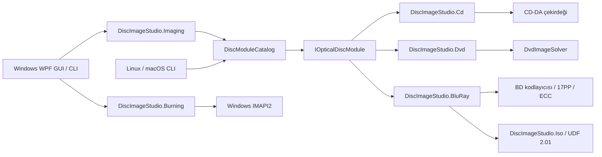

# Mimari

[简体中文](ARCHITECTURE.md) | [繁體中文](ARCHITECTURE.zh-TW.md) | [English](ARCHITECTURE.en.md) | [日本語](ARCHITECTURE.ja.md) | [Türkçe](ARCHITECTURE.tr.md)

## Amaç

Temel amaç, uygulama kabuğunu belirli bir disk kodlamasına bağımlı olmaktan çıkarmaktır. CD, DVD ve Blu-ray fiziksel modülasyon, hata düzeltme, sektör düzeni ve dosya sistemi bakımından farklıdır. Bu nedenle ortak olan, iş yaşam döngüsü ve ürün yetenekleridir; yanlış bir “evrensel kodlayıcı” temel sınıfı değildir.

`DiscImageStudio.Cli` ve Windows masaüstü uygulaması çevrimdışı komutları aynı modül kataloğundan çalıştırır. `DiscImageStudio.ImageIO`, Windows masaüstü hedefinde WIC kullanır; genel `net10.0` hedefinde görüntüleri StbImageSharp ile okur, PNG dosyalarını .NET `ZLibStream` kullanan yerleşik PNG kodlayıcısıyla yazar. Her iki arka uç da üreticilere aynı sırada BGRA pikselleri sağlar. Blu-ray, alfa birleştirme ve gri tonlama dönüştürme kodunu paylaşır; CD ve DVD de kendi mevcut örnekleme algoritmalarını paylaşır.

`DiscImageStudio.Localization`, masaüstü, CLI, Core ve ortam modüllerinin paylaştığı platformlar arası metin altyapısıdır; beş dilde gömülü kaynak, dil seçimi ve biçimlendirme sağlar. WPF metin uzantısı App içinde kalır. Komut ve seçenek tanımlayıcıları, serileştirilen alanlar ve kullanıcı içeriği arayüz diliyle değişmez; yalnızca UI culture değiştirilir, sayısal ayrıştırma veya proje parametreleri değiştirilmez. Dinamik arayüz metinleri dil değişimini izler; sınıflandırmada kullanılan özgün kalibrasyon uyarıları görüntülenirken çevrilir. Bakım süreci için [LOCALIZATION.md](LOCALIZATION.tr.md) belgesine bakın.

## Core sözleşmeleri

`DiscImageStudio.Core`, WPF, CD, DVD veya belirli bir kodlayıcıya başvurmaz ve `net10.0` hedefini kullanır.

- `IOpticalDiscModule`: Modül yürütme sınırı.
- `DiscModuleDescriptor`: Modül kimliği, ortam ailesi, iptal desteği ve komut meta verileri.
- `DiscCommandDescriptor`: Gelecekte dinamik arayüz üretiminde de kullanılabilecek komut, yetenek ve seçenek tanımları.
- `DiscJobRequest`: Ortak komut ve parametre taşıyıcısı.
- `DiscJobProgress`: Ortamdan bağımsız ilerleme, aşama, tamamlanan miktar ve geçen süre.
- `DiscJobResult`: Çıkış kodu, özet ve çıktı yolları.
- `DiscModuleCatalog`: Komut yönlendirme, yinelenen komut denetimi ve modül yürütme.
- `ToneProfile` / `ToneDither`: CD/DVD/BD için ortak ton modeli (renk taklidi gücü, gri seviye sayısı, parlaklık, sRGB doğrusallaştırma) ve belirlenimci renk taklidi fazı. CD/DVD, mantıksal bayt indeksinde renk taklidi uygular; böylece CD gecikmeli serpiştirmesinden sonra da önizlemede yeniden üretilebilir. BD, kaynak görüntü çözünürlüğünde tek seferlik nicemleme yapar; üretim, yazma ve önizleme aynı ikili rasteri kullanır.

`OpticalDiscFamily` türünün üç değeri de (`CompactDisc`/`Dvd`/`BluRay`) uygulanmıştır. Proje, önayar, tasarım, önizleme, dışa aktarma, diske yazma ve kalibrasyon bu üç disk türüne göre dallanır.

Disk önayarları Core içindeki ortak `disc-presets.json` dosyasında (schema 4) tutulur: `cdPresets`, `dvdPresets` ve `bluRayPresets` gruplarının her biri ayrı bir devre dışı bırakma listesine sahiptir. Eski schema 2/3 dosyaları okunurken yerleşik BD şablonları eklenir ve bir sonraki kayıtta şema yükseltilir.

## Proje modeli ve kabuk

`DiscImageStudio.Core.ProjectJsonStore`, `.discproj` dosyasını (UTF-8 JSON, schemaVersion 2) yönetir: proje adı, disk türü (CD/DVD/BD), geometri (CD için r0/r1/sektör; DVD için ayrıca kübik iz aralığı katsayıları; BD için 32 sektör hizalaması, tek katman kapasitesi ve ≤60 mm şartı), katman listesi, çıktı ayarları, isteğe bağlı `tone` ton bölümü, isteğe bağlı `bluRay` kutupluluk bölümü, kalibrasyon kaydı yolu ve kayıt sırasında oluşturulan küçük resim. `tone` yoksa eski sabit eşik yöntemi kullanılır; schemaVersion 1 CD/DVD dosyaları okunduktan sonra otomatik olarak 2 sürümünde yazılır. BD için `bluRay.invertMapping` yalnızca BD projelerinde bulunur; CD/DVD dosyalarında bu bölüm varsa dosya reddedilir. Okuma ve yazma doğrulamadan geçer, geçici dosyayla atomik değiştirme uygulanır; kurallar önayar JSON dosyasıyla aynıdır. Katmanlar görüntülere mutlak yollarla başvurur; kaynakları toplamaz.

Kabuk bir çalışma alanı modelidir: başlangıç sayfası (kenar çubuğu yoktur; yeni/aç işlemleri, şablon kartları ve son projeler bulunur) ile beş proje çalışma alanı: Tasarım / Önizleme / Dışa aktarma / Diske yazma / Kalibrasyon (`Workspace` enum türü; kenar çubuğundaki sıra iş akışının sırasıdır). Her çalışma alanı aynı projenin bir görünümüdür; birbirinden bağımsız süreçler değildir. Tek bir `DiscParametersState` paylaşılır; proje açılırken `ProjectSession` belge içeriğini buraya doldurur, kaydederken yeniden belgeye alır. Böylece önizleme, dışa aktarma, yazma ve kalibrasyonun State bağlamaları proje yaşam döngüsünden tamamen ayrılır. Değişiklik işareti yalnızca proje dosyasına yazılan State özelliklerini izler.

Ana pencerenin özel chrome çerçevesi `WindowWorkArea` tarafından sınırlandırılır: `WM_GETMINMAXINFO` içinde, mevcut monitörün fiziksel çalışma alanına göre (görev çubuğu, negatif koordinatlı monitörler ve farklı DPI değerleri dahil) en büyük konum ve boyut ayarlanır; pencere monitör değiştirince, çözünürlük veya DPI değişince en küçük boyut yeniden hesaplanır. `SystemParameters.WindowResizeBorderThickness` tarafından sağlanan birincil monitör kenar boşluklarına artık bağımlı değildir.

İş akışı kabuktaki iki öğeyle görünür tutulur: sayfa başlığının (`PageHeader`) başlık satırının altındaki **aşama çubuğu** (`StageBar`: Tasarım → Önizleme → Dışa aktarma → Diske yazma │ Kalibrasyon; mevcut aşama marka mavisiyle vurgulanır, geçmiş aşamalar onay işaretiyle soluk gösterilir, her aşamaya tıklanarak gidilebilir) ve başlığın sağ yuvasındaki “Sonraki adım” düğmesi. İkisi de pencere üzerinden `NavigateTo` ile bağlanır. Pencere tüm sayfa örneklerini tutar; çalışma alanı değişince `CurrentWorkspace` değerini her sayfanın aşama çubuğuna iletir. Böylece iş akışı her sayfada, kenar çubuğuna bağımlı olmadan görünür ve erişilebilir kalır.

Çalışma alanı sayfaları ortak bir iskelet ve panel dili kullanır. `MonitorCard` (başlık simgesi + başlık + alt başlık + eylem yuvası, ana içerik ve isteğe bağlı alt durum çubuğu), önizleme sonuçlarını ve kalibrasyon fotoğrafı sahnesini barındırır. `StepCard` (numaralı adım kartı: Başlamadı/Devam ediyor/Tamamlandı durum rozeti + daraltılabilir içerik), kalibrasyon sayfasının üç adımlı denetleyicisini barındırır; etkin adım açılır, diğerleri daraltılır. `VisibilityGate` (tek bir boolean değere göre içeriği gösterir/gizler) sayfalardaki disk türü/mod dallarını birleştirir ve görünümlere özel DataTrigger stillerinin yerini alır. `PathField` ve `SourceChip`, tekrarlanan yol satırları ile kaynak çubuklarını tek uygulamada toplar. `EmptyStateCard` (simge + tek cümle + gezinme eylemi) boş durum yönlendirmesini birleştirir. Kart başlıkları iki çeşittir: izleme/liste kaplarında `CardHeaderBandStyle` renk şeridi başlığı (MonitorCard ve Tasarım katman kartı), form kartlarında düz başlık kullanılır; her ikisinde de simgeler 15px boyutundadır. `SourceChip` öğesinin `Actions` yuvası “sahibine git” düğmesini barındırır; bu nedenle “salt okunur özet + gezinme” satırı tüm sayfalarda aynı görünür. Yoğunluk kuralları: kenar çubukları/denetleyici panelleri Compact ailesini (36 px), ana sahne ve birincil eylem düğmeleri standart yüksekliği (44 px), iki yan panel ise ortak `SidePanelWidth` (280) belirtecini kullanır. Uzun çevirilerde başlıklar, alan etiketleri ve kalibrasyon eylem düğmeleri satır kaydırıp içerikle büyür; eylem düğmeleri Compact en küçük yüksekliğini korur.

Kenar çubuğunda her çalışma alanının simgesi vardır; 72 px genişliğe daraltılınca bir simge çubuğuna dönüşür (dar durumda grup başlıkları gizlenir, alt öğeler doğrudan listelenir). Açılması için ikinci bir tıklama gerektiren daraltılmış simge listesi yoktur. Başlık çubuğunun sağında kalıcı bir “dişli + Ayarlar” düğmesi (`TitleBar.ShowSettingsButton` + `SettingsRequested`) bulunur; ana sayfadan ve tüm çalışma alanlarından ayarlar tek tıklamayla açılır. Başlık çubuğu düğmeler için ayrı bir sütun ayırır, uzun proje adları otomatik kısaltılır. Küçült düğmesinin solundaki “…” uygulama menüsü yalnızca “Hakkında…” seçeneğini sunar (`TitleBar.ShowAppMenu` + `AppMenuRequested`); Ctrl+, da ayarları doğrudan açar. İletişim kutularında uygulama girişleri gösterilmez ve kenar çubuğunun altında artık “Hakkında” girişi bulunmaz.

`DesignView` ve `CalibrationView`, sayfa genişliğine göre düzen değiştirir. Geniş pencerede çalışma alanı görüntü alanı yüksekliğine sabitlenir (sabit değer dış `ScrollViewer` görüntü alanı/içerik boyutu değişince yeniden hesaplanır; ilk yerleşimde görüntü alanının sıfır olması veya DPI yuvarlamasında bir piksellik fark gibi geçici durumlar sayfayı gereksiz kaydırma durumunda bırakmaz). Dar pencerede yan panel sahnenin altına geçer ve tüm sayfa kaydırılır (Tasarım sayfasında genişlik < 900, Kalibrasyon sayfasında < 990). Dar Tasarım düzeninde tuvale sabit yükseklik verilir; üç sütun sıkışınca tuval kullanılamayacak kadar küçülmez. Tasarımın sağ sütunu doğal yüksekliğe sahip “Özellikler + Ton” kartlarından oluşur ve kendi `ScrollViewer` öğesiyle kaydırılır; sayfa genişliği < 900 olduğunda katman kartının altına geçip tüm sayfayla birlikte kaydırılır. Ton modülü (`TonePanel`) bağımsız bir UserControl öğesidir: 280 px sağ sütunda küçük disk yüzeyi + tek sütunlu denetimler, alt satıra geçmiş tam genişlikte ise solda büyük disk yüzeyi ve sağda denetimler kullanır (kendi ad kapsamı vardır; sayfa düzeyindeki `x:Name` bu sınırı aşamaz).

Önizleme sayfasının parametre panelini `PreviewInspectorViewModel` sağlar. CD, DVD ve BD parametrelerini aynı satır grubuna (`ArtifactPath`, `ArtifactLabel`, `MeasuredInnerRadius`, `PreviewSize`, `SamplesPerSector` …) yansıtır. Sayfa içinde disk türü anahtarı yoktur; izdüşüm önizlemesi kesin olarak projenin disk türünü izler. Proje açılırken `SetDiscType` ile belirlenir; denetleyici aynı satırların hedefini mevcut türe yöneltir, ikinci bir panel kopyası getirmez. Salt okunur grup (üretim geometrisi), `DiscParametersState` tarafından hazırlanmış metni gösterir ve parametrelerin sahibine geçiş sağlar. Üretilmiş çıktıyı geri okuma modu ayrıca ortak `CdInterleave` değerine doğrudan bağlı “Serpiştirmeyi geri al” anahtarını sunar; böylece sidecar dosyası olmayan harici ses izleri, kullanıcının bildirdiği serpiştirme düzeniyle okunabilir. BD için sektör başına örnek sayısı yoktur. Önizlemeye ait gruplardaki (ölçülen yarıçap ve iz aralığı, önizleme kalitesi) değişiklikler mevcut disk türüne yazılır ve “Ölçülen parametreler ve önizleme kalitesi (gelişmiş)” açılır panelinde toplanır. BD çıktısı geri okunurken aynı adlı sidecar otomatik okunur; toplam sektörler, yarıçaplar, çizim başlangıcı/bitişi, kutupluluk ve ton geri yüklenir. Sidecar dosyası olmayan harici ISO dosyaları mevcut proje geometrisiyle okunur.

Tasarım izdüşümü ve üretilmiş çıktıyı geri okuma aynı 8192×8192 çözünürlük üst sınırını paylaşır: CD/DVD için 256–8192 px, BD için 64–8192 px; sınır dışı değerlerde en yakın sınır kullanılır. Varsayılan boyutlar CD 1600, DVD 1200, BD 2048 px olarak kalır; gelişmiş parametrelerdeki “Dışa aktarma boyutu (px)” ile ayrıntı artırılabilir. “Önizlemeyi dışa aktar” mevcut işlenmiş PNG dosyasını kaydettiğinden bu boyutu kullanır.

Parametre sahipliği ve aşamalı gösterim:

- **Üretim geometrisi** (r0, r1, sektörler, DVD'nin üç iz aralığı terimi) yalnızca proje ayarları iletişim kutusunda düzenlenir. Diğer çalışma alanları salt okunur özet (`GeometrySummary`) ve doğrudan erişim için “Düzenle…” düğmesi gösterir; ayrı bir düzenleyici sunmaz.
- **Disk önayarları** üretim geometrisi için kısayoldur ve aynı yere aittir: yeni proje oluştururken soldaki şablon listesinden seçilir (katalogdaki elle ayarlananlar dışındaki tüm önayarlar listelenir). Proje ayarları iletişim kutusu artık disk türü ve önayar seçimi göstermez; disk türü projeyle sabittir. Parametre alanının altındaki “Bu parametreleri önayar olarak kaydet” eylemi mevcut alanları kullanıcı önayar JSON dosyasına ekler (ad ayrı bir pencerede onaylanır; kayıt sonrası katalog hemen yenilenir).
- **Teslim parametreleri hedefe göre ayrılır**: Dışa aktarma çalışma alanı yalnızca dosya yazmayı (çıktı yolu, CUE, serpiştirme, ISO/veri klasörü/birim etiketi), Diske yazma çalışma alanı yalnızca disk yazmayı (yazılacak içerik, disk yazıcısı ve hız) yönetir. İkisi de dışa aktarma kalitesindeki aynı bileşik görüntüyü kullanır; dosyada doğrulanan içerik diske yazılan içeriktir. Yazma işlemindeki CD/DVD türü kaynaktan (proje türü veya kalibrasyon deseni türü) türetilir; yanlış tarafa alınabilecek bir anahtar yoktur. Yazma sayfasındaki “Yazılacak içerik” bölümlü denetimi sayfa düzeyinde kaynak seçimidir (Önizleme sayfasındaki “Tasarım izdüşümü / Üretilmiş çıktıyı geri oku” düzeniyle aynıdır). Proje bileşiği seçilince doğrudan kaynak özeti, yardımcı kalibrasyon deseni seçilince Kalibrasyon çalışma alanına bağlantı gösterilir. Kaynak seçimi artık hedef anahtarının içine gömülü değildir.
- **Ton**, üretim parametresidir ve Tasarım çalışma alanının sağ sütununa aittir: renk taklidi gücü (0–100%, yeni projede 75%), sRGB doğrusallaştırma (gama), CD gri seviye sayısı (2/4 seviye; DVD/BD sabit 2 seviye) ve parlaklık (±64), projenin `tone` bölümüne yazılır. Üretim, akışla yazma, geri okuma ve kalibrasyon izdüşümü aynı `ToneProfile` kullanır. BD ayrıca 3T/6T kutupluluk anahtarına sahiptir; veride bağımsız `bluRay.invertMapping` alanıdır, `ToneProfile` içine konmaz. Modülün disk yüzeyi önizlemesi aynı eşlemeyle mevcut bileşiği yansıtır, kaydırıcılar sürüklenince hemen güncellenir. Dışa aktarma sayfasında yalnızca çıktı seçenekleri ve tonun Tasarım sayfasında düzenlendiği bilgisi kalır; Önizleme sayfasında aynı düzenleme tekrarlanmaz.
- **Önizlemeye özel parametreler** (ölçülen yarıçap, dışa aktarma boyutu, sektör başına örnek sayısı) proje parametresi değil inceleme davranışı olduğundan Önizleme sayfasında kalır. Proje açılırken ölçülen geometri önce proje geometrisini izler; tasarım izdüşümü böylece varsayılan olarak nötrdür. Kullanıcı ölçülen değerleri girdikten sonra iki geometri arasındaki fark gösterilir; bunları kendiliğinden değiştiren tek süreç kalibrasyondur.

Tasarım çalışma alanı (`DesignViewModel` + `DiscDesignCanvas` + `DesignComposer`) katman yığınını yönetir. Katmanlar panel sırasıyla saklanır (üstteki indeks 0; tuval, birleştirme sırasıyla uyumlu olarak aşağıdan yukarı çizer). Tuval, disk merkezini başlangıç alan mm koordinatlarıyla çizer; sürükleme/köşeden ölçekleme/döndürme tutamacını destekler. Katman satırları seçilebilir listedir; tuval ve özellik paneliyle çift yönlü eşitlenir. Katman düzenlemelerinden 450 ms sonra, yeni değişiklik yoksa `DesignComposer` kare bileşik görüntüyü üretir (önizleme 2048 px, dışa aktarma 8192 px). Karenin merkezi disk merkezi, kenarı 2 × tuval dış yarıçapıdır (CD sabit 57.5 mm; DVD/BD üretim dış yarıçapını kullanır). Bileşik, State içindeki kaynak görüntü yoluna yazılır ve dışa aktarma ile önizlemenin ortak girdisi olur; üretim CLI'si ve işlem hattı bunun farkında değildir. Dışa aktarma ve diske yazma, dışa aktarma kalitesindeki 8192 px bileşiği kullanır; önizlemede doğrulanan içerik diske yazılan içeriktir. Başlıktaki “Sonraki adım”, Tasarım → Önizleme → Dışa aktarma → Diske yazma sırasını izler; Kalibrasyona kenar çubuğu veya yazma sayfasındaki bağlantıdan girilir.

Tasarım dili `Themes/Tokens.xaml` (renkler, anlamsal renkler, `RadiusChip`/`RadiusPanel`/kart üst-alt yansıtılmış eğrileri dahil köşe yarıçapları, denetim yükseklikleri, `SidePanelWidth`, sayfa boşlukları, açılır katman gölgeleri, tuval paleti) ve `Themes/Controls.xaml` (metin hiyerarşisi, düğme aileleri, giriş denetimleri, liste satırları, açılır paneller, `DangerCard` uyarı kartı, izleme ve adım kartı şablonları) içinde toplanır. Kod tarafındaki animasyonlar `Controls/Motion.cs` içindeki üç süreyi kullanır; özel tuvaller renkleri ve disk çizimini `Controls/DiscTheme.cs` ile `Controls/DiscRenderCore.cs` üzerinden alır, kendi paletlerini barındırmaz. `Controls.xaml` içinde örtük stillerden türetilen stiller (`BasedOn="{StaticResource {x:Type X}}"`) örtük stilden sonra yazılmalıdır: ileri başvuru hata vermez, sessizce Windows yerleşik stiline döner ve denetimler açık sistem görünümüyle belirir. Sayfanın adlandırılmış içeriğini barındıran paneller (`MonitorCard` gibi), UserControl yerine şablonlu özel denetim olmalıdır: UserControl içeriği kendi ad kapsamına ayırır; sayfadaki `x:Name` öğeleri derlenemez, anlık görüntü kancaları ve tuval bağlantıları da bunlara erişemez.

Tema değişimi anlıktır: `Themes/Palette.Light.xaml`, `Tokens.xaml` içindeki tüm renk ve fırça anahtarlarını geçersiz kılar; `Services/ThemeResolver`, birleştirilmiş sözlüklerde indeks 1'e açık tema katmanını ekler veya kaldırır; pencere yeniden oluşturulmaz. Bu nedenle görünümler palet anahtarlarında `DynamicResource` kullanmalıdır (`StaticResource`, koyu değeri yükleme anında sabitler; `ThemePaletteTests` bunu yakalar). Renkleri koddan alan denetimler (`SideNavItem`, `SegmentedControl`, `DiscDesignCanvas`, `CalibrationPhotoCanvas`, `JobDock`, `HelpHint`), `ThemeResolver.Changed` olayına abone olup belirteçleri yeniden okur. Sistem teması `HKCU\...\Themes\Personalize\AppsUseLightTheme` üzerinden alınır.

Uygulama ayarları `Services/AppSettingsStore` tarafından `%LOCALAPPDATA%\DiscImageStudio\settings.json` konumuna kaydedilir (camelCase, metin olarak enum değerleri, geçici dosyayla atomik değiştirme): dil, tema, varsayılan proje konumu ve önbellek konumu. Dosya eksik, bozuk veya schemaVersion mevcut sürümden yüksekse varsayılanlara dönülür; elle bozulan yollar `AppSettings.Normalize` içinde atılır. Ayarlar `.discproj` içine yazılmaz. Varsayılan proje konumu yalnızca yeni proje iletişim kutusunun başlangıç dizinini etkiler; mevcut değilse sistem Belgeler dizinine dönülür. `Services/TempFiles`, yapılandırılabilir önbellek dizinini (`LivePreviewDirectory`) tutar; tasarım bileşikleri, küçük resimler ve önizlemeler buraya yazılır. Değişiklik yalnızca yeni işleri etkiler. Önbellek temizliği dosya adı izin listesine göre (`design-composite-*`, `design-tone-*`, `design-thumbnail.png`, `cd/dvd/bd-live-*` ve bunların `.png.json` sidecar dosyaları) siler; dizinleri, projeleri veya dışa aktarılan dosyaları silmez. Ayarlar penceresi kayda kadar yalnızca kopyayı değiştirir; İptal veya Esc tüm düzenlemeleri atar.

## Görüntü ön işleme katmanı

`DiscImageStudio.Imaging`, arayüz ve ortam kodlama modülleri arasında yer alır. Tasarım bileşiğinin nihai üretim boyutunu (8192 px) tanımlayan `RingImageQuality` sabitini barındırır; tasarım birleştirme, dışa aktarma ve akışla yazma bunu paylaşır. Bağımsız renk taklidi aracının kullandığı `GrayscaleDither` da buradadır: görüntüleri nominal gri seviye paletleriyle işler, isteğe bağlı sRGB doğrusallaştırma uygular, boyutları ve DPI değerini korur. Görüntünün disk yüzeyine yerleşimini (ölçekleme, ortalama, içerik halkasına kırpma), Tasarım sayfasının `DesignComposer` bileşeni mm tuvalinde yapar. Dışa aktarma/yazma/önizleme doğrudan bileşiği kullanır; normal disk yüzeyi üretiminde ayrı bir ön işleme adımı yoktur.

## Akışla diske yazma katmanı

CD için `OpticalBurnRequest.ProduceContent`, açıkça başlıksız 44.1 kHz, 16 bit, stereo, küçük uçlu PCM ister; `ContentLength` yalnızca ses verisini sayar. CD üreticisinin varsayılan başlıksız akışı eski büyük uçlu çıktıyı korur; IMAPI çağrılırken kabuk açıkça `CdAudioByteOrder.LittleEndian` seçer. Dönüşüm, gecikmeli serpiştirme bittikten sonra tam sektör çıktısı sırasında yapılır. Dosya üretimi `.wav` / `.raw` uzantısına göre biçim seçer: WAV aynı küçük uçlu ses verisine ek olarak 44 bayt RIFF başlığı ve aynı adlı WAVE CUE dosyası yazar; eski RAW büyük uçlu kalır. Windows RAW görüntü oluşturucusunun verilen baytları değiştirmeden koruduğu ölçülmüştür; bayt sırasını düzeltmez. Ayrıntılar için [CD yazma uyumluluğu](CD_AUDIO_COMPATIBILITY.tr.md) belgesine bakın.

`DiscImageStudio.Burning` yalnızca Windows IMAPI2 aygıt listeleme, ortam denetimi, COM `IStream` uyarlaması, 64 MiB sınırlı bellek tamponu (yazma öncesi 32 MiB ön dolum) ve yazma yaşam döngüsünden sorumludur. Otomatik hız, CD/DVD yazması gerçekten başlarken mevcut diskin yazma yapılandırmalarını yeniden okuyup en düşük değeri seçer; elle seçim değişmez. Aygıt hız bildirmiyorsa yazma arayüzünün temkinli yedek değeri kullanılır. Ortam biçimi yine CD/DVD üreticilerine aittir: CD sırayla 2352 bayt ses sektörleri, DVD hızlı algoritması 2048 bayt veri sektörleri üretir. Disk yazıcısı bu blokları gerektiğinde okur; böylece depolamaya tam bir görüntü yazılmaz. Eski dosya çıktı girişleri bu katmandan geçmez; başarısızlık mevcut iş akışını bozmaz.

DVD karma klasör modu iki aşamalı sıralı üretim kullanır: ilk aşamada dizin taranır, ISO9660/Joliet meta verileri, dosya extent alanları ve çizim başlangıç/bitiş LBA değerleri belirlenir. İkinci aşama, planlanan disk sırasıyla çıktı verir. İç halka modu “meta veriler → dosyalar → desen”, dış halka modu “meta veriler → desen → dosyalar” sırasındadır. Desen 16 sektörlük ECC Block sınırına hizalanır. Yerleşim planı yalnızca meta verileri tutar, dosya içeriğini önbelleğe almaz ve Seek desteklemeyen akışları destekler.

BD-R aynı yazma sözleşmesini kullanır: `BluRayIsoGenerator`, tek bir ileri akışta UDF 2.01, desen alanı ve disk sonundaki yedek meta verileri yazar. Dış halka modunda bütün dosya bölümü sondaki yedek alanın önüne taşınır; desen her zaman 32 sektör hizalıdır ve bölümün dışında kalır. Yazma sayfası bu akışı doğrudan MMC sıralı yazma oturumuna verir; tam 25 GB görüntüyü depolamaya yazmaz. BD yedek alana yeniden eşleme sunmaz; kesinti sonrası diske genellikle devam edilemez.

`ProjectOutputs.FilesAtOuterRing` isteğe bağlıdır ve varsayılanı `false` değeridir. DVD/BD, ortak parametre durumu üzerinden dışa aktarma, önizleme ve yazmayı kendi içinde eşitler. GUI önizlemesinde dosya alanı, gerekli dosya sistemi ayrılmış alanlarını da kapsayarak çizim başlangıç/bitiş sınırlarına göre sarıyla gösterilir; bu renklendirme üreticiye girmez. Mevcut çıktılar sidecar dosyasındaki sabit aralıklara dayanır; yerleşim mevcut dizinden yeniden tahmin edilmez.

## Modül sınırları

### CD

`DiscImageStudio.Cd`, CD geometrisini, görüntü örneklemeyi, RAW çıktıyı ve gecikmeli serpiştirmeyi yönetir. İptali uygular, bayt ilerlemesini ortak `DiscJobProgress` biçimine dönüştürür.

### DVD

`DiscImageStudio.Dvd` ince bir uyarlayıcıdır. Yalnızca meta veriler, yönlendirme ve sonuç normalleştirmesinden sorumludur; ardından yalıtılmış `DvdImageSolver` bileşenini çağırır. DVD motorunun özgün parametreleri ve öz sınamaları korunur.

### Blu-ray

`DiscImageStudio.BluRay`, BD geometrisi, 17PP, EDC/Reed-Solomon/LDC-BIS, 3T/6T run-count eşlemesi, akışla üretim ve ISO planını yönetir; UDF 2.01 yazmak için `DiscImageStudio.Iso` kullanır. GUI'ye işleri yalnızca Core sözleşmeleriyle sunar; CD/DVD iç türlerine başvurmaz veya bunları değiştirmez. BD için `ToneProfile`, kaynak görüntü çözünürlüğünde nicemleme yapar; `BluRayRunLengthMapping` yalnızca 128 eşiği ve kutupluluk değişimini uygular. Üretim sırasında ISO'nun yanına `bd-r-image-v1` sidecar dosyası yazılır; sektörler, yarıçaplar, çizim başlangıcı/bitişi, kutupluluk, ton ve UDF zaman damgaları kaydedilir.

## Genişletme kuralları

1. Modül kimlikleri ve komut adları genel olarak benzersiz olmalıdır; katalog çakışmaları başlangıçta reddeder.
2. Modüller GUI denetimlerinden durum okumamalıdır; tüm girdiler `DiscJobRequest` üzerinden gelir.
3. Modüller doğrudan pencere göstermemelidir; günlük, ilerleme ve sonuçlar sözleşme üzerinden döndürülür.
4. Alt algoritma güvenle iptal edilemiyorsa `SupportsCancellation`, `false` olmalıdır.
5. Ortama özgü biçimler kendi modülünde kalır; yalnızca kararlı ve gerçekten ortak kavramlar Core'a girer.
6. Yeni modüller katalog yönlendirme testi ve en küçük çıktı için bir duman testi eklemelidir.
