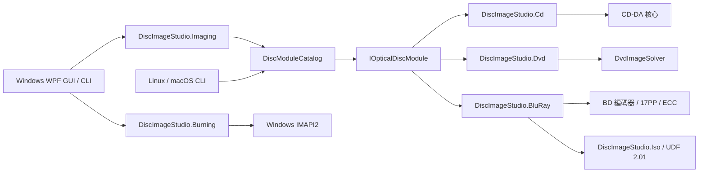

# 架構說明

[简体中文](ARCHITECTURE.md) | [繁體中文](ARCHITECTURE.zh-TW.md) | [English](ARCHITECTURE.en.md) | [日本語](ARCHITECTURE.ja.md) | [Türkçe](ARCHITECTURE.tr.md)

## 目標

核心目標是讓應用程式外殼不依賴單一光碟編碼。CD、DVD、藍光的實體調變、錯誤更正、磁區組織與檔案系統不同，因此共用的是工作生命週期與產品能力，而非不適當的「萬用編碼器」基底類別。

`DiscImageStudio.Cli` 與 Windows 桌面程式透過同一份模組目錄執行離線命令。`DiscImageStudio.ImageIO` 在 Windows 桌面目標使用 WIC，在通用 `net10.0` 目標使用 StbImageSharp 讀圖，並以基於 .NET `ZLibStream` 的內建 PNG 編碼器寫圖。兩個後端皆向產生器提供相同順序的 BGRA 像素。藍光共用透明度合成與灰階轉換程式碼，CD 與 DVD 也分別共用各自原有的取樣演算法。

`DiscImageStudio.Localization` 是桌面、CLI、Core 與媒體模組共用的跨平台文字基礎層，提供五種語言的嵌入式資源、語言選擇與格式化。WPF 文字擴充留在 App，命令與選項識別碼、序列化欄位及使用者內容不隨介面語言改變；僅切換 UI culture，不改變數值解析或專案參數。動態介面文字隨語言切換更新，分類用的原始校準警告在顯示時翻譯。維護流程見 [LOCALIZATION.md](LOCALIZATION.zh-TW.md)。

## Core 契約

`DiscImageStudio.Core` 不參考 WPF、CD、DVD 或任何具體編碼器，並以 `net10.0` 為目標。

- `IOpticalDiscModule`：模組執行邊界。
- `DiscModuleDescriptor`：模組 ID、媒體家族、取消能力與命令中繼資料。
- `DiscCommandDescriptor`：命令、能力與選項定義，可供未來動態產生介面。
- `DiscJobRequest`：統一命令與參數載體。
- `DiscJobProgress`：與媒體無關的進度、階段、完成量與耗時。
- `DiscJobResult`：結束代碼、摘要與輸出路徑。
- `DiscModuleCatalog`：命令路由、重複命令檢查與模組執行。
- `ToneProfile` / `ToneDither`：CD/DVD/BD 共用影調模型（抖色強度、灰階階數、亮度、sRGB 線性化）與確定性抖色相位。CD/DVD 以邏輯位元組索引抖色，因此 CD 延遲交錯後仍可在預覽重現；BD 在來源圖片解析度一次量化，產生、燒錄與預覽共用相同二值點陣。

`OpticalDiscFamily` 的三種值（`CompactDisc`/`Dvd`/`BluRay`）皆已實作；專案、預設、設計、預覽、匯出、燒錄與校準皆依此三種光碟類型分支。

光碟預設由 Core 的統一 `disc-presets.json`（schema 4）承載：`cdPresets`、`dvdPresets`、`bluRayPresets` 三組，各有獨立停用清單。讀取 schema 2/3 舊檔案時補入內建 BD 範本，於下次儲存時升級。

## 專案模型與外殼

`DiscImageStudio.Core.ProjectJsonStore` 持有 `.discproj`（UTF-8 JSON，schemaVersion 2）：專案名、光碟類型（CD/DVD/BD）、幾何（CD r0/r1/磁區；DVD 加三次軌距係數；BD 要求 32 磁區對齊、單層容量與 ≤60 mm）、圖層清單、輸出設定、選用 `tone` 影調區段、選用 `bluRay` 極性區段、校準記錄路徑與儲存時繪製的縮圖。缺少 `tone` 表示舊版硬閾值；schemaVersion 1 的 CD/DVD 檔案讀取後自動以 2 寫回。BD 的 `bluRay.invertMapping` 僅存在於 BD 專案，CD/DVD 帶有此區段會被拒絕。讀寫皆經驗證並使用暫存檔原子取代，規則與預設 JSON 相同。圖層以絕對路徑參考圖片，不收集素材。

外殼採用工作區模型：起始頁（無側邊欄，提供新增／開啟、範本卡片與最近專案），加上五個專案工作區——設計／預覽／匯出／燒錄／校準（`Workspace` 列舉，側邊欄順序即工作流程順序）。各工作區是同一專案的不同視角，並非獨立流程：共用一個 `DiscParametersState`，開啟時由 `ProjectSession` 將文件內容填入，儲存時再擷取回文件；預覽、匯出、燒錄、校準對 State 的繫結因此與專案生命週期解耦。未儲存標記僅追蹤會寫入專案檔的 State 屬性。

主視窗自訂視窗框架由 `WindowWorkArea` 約束：在 `WM_GETMINMAXINFO` 中依目前螢幕的實體工作區（含工作列、負座標螢幕與不同 DPI）設定最大位置／尺寸，並在跨螢幕、解析度或 DPI 變更時重算最小尺寸，不再依賴 `SystemParameters.WindowResizeBorderThickness` 的系統主螢幕邊距。

工作流程由兩個外殼設施呈現：頁首（`PageHeader`）標題列下的**階段列**（`StageBar`，設計 → 預覽 → 匯出 → 燒錄 │ 校準，目前階段以品牌藍強調，已完成階段以勾號淡化，各階段皆可點選直達），以及頁首右側的「下一步」按鈕。兩者皆由視窗接至 `NavigateTo`：視窗持有全部頁面執行個體，切換工作區時將 `CurrentWorkspace` 傳給各頁階段列，讓每頁皆能檢視及存取流程，不依賴側邊欄。

工作區頁面共用骨架與面板設計：`MonitorCard`（監視卡：標頭圖示、標題、副標題、動作槽、主體、選用狀態底列）承載預覽與校準相片舞台；`StepCard`（編號步驟卡：待開始／進行中／已完成徽章與可摺疊主體）承載校準頁三步檢查器，展開作用中步驟並收合其餘；`VisibilityGate` 依單一布林值顯示／隱藏內容，統一光碟類型與模式分支，取代各檢視私有 DataTrigger 樣式；`PathField`、`SourceChip` 統一路徑列與來源列；`EmptyStateCard`（圖示、一句說明、導向動作）統一空白狀態引導。監視／清單容器使用 `CardHeaderBandStyle` 色帶標頭（MonitorCard、設計頁圖層卡），表單卡維持平鋪標題，圖示皆為 15px。`SourceChip` 的 `Actions` 槽承載「前往擁有者」按鈕，使唯讀摘要與導向列在各頁外觀一致。側欄／檢查器面板使用 Compact 家族（36 px），主舞台與主要動作用標準高度（44 px），兩側面板共用 `SidePanelWidth`（280）。較長翻譯的標題、欄位標籤與校準動作按鈕可換行並依內容增高，動作按鈕保留 Compact 最小高度。

側邊欄各工作區項目皆有圖示，收合為 72 px 即成圖示列（隱藏群組標頭、直接列出子項），不再需要再次點選才能展開摺疊圖示清單。標題列右側常駐「齒輪＋設定」按鈕（`TitleBar.ShowSettingsButton` + `SettingsRequested`），首頁與各工作區皆可直接開啟設定；獨立按鈕欄使長專案名自動省略。最小化左側的「…」選單僅提供「關於」（`TitleBar.ShowAppMenu` + `AppMenuRequested`），Ctrl+, 也可開啟設定；對話框不顯示應用程式入口，側邊欄底部不再保留「關於」。

`DesignView` 與 `CalibrationView` 依頁寬切換配置：寬視窗將工作區固定為檢視區高度，隨外層 `ScrollViewer` 的檢視區／內容尺寸變化重算；首次零高度、DPI 四捨五入差一像素等暫態不會使頁面停留在無意義捲動狀態。窄視窗將側欄移至舞台下方並整頁捲動（設計頁 < 900、校準頁 < 990）。設計頁窄配置使用固定畫布高度，避免三欄擠壓至無法使用。右欄的「屬性＋影調」卡片按內容自然增高，由獨立 `ScrollViewer` 捲動；頁寬 < 900 時移至圖層卡下方並隨整頁捲動。`TonePanel` 為獨立 UserControl，在 280 px 右欄使用縮小碟面與單欄控制項；折疊後整寬配置改為左側大碟面、右側控制項。它有獨立名稱範圍，頁面 `x:Name` 不可穿透。

預覽參數面板由 `PreviewInspectorViewModel` 提供，將 CD/DVD/BD 三組參數投影至相同列（`ArtifactPath`、`ArtifactLabel`、`MeasuredInnerRadius`、`PreviewSize`、`SamplesPerSector` …）。頁內無光碟類型切換：投影嚴格跟隨專案類型，開啟時由 `SetDiscType` 指定，檢查器僅重新指向既有列，不另建面板副本。唯讀產生幾何由 `DiscParametersState` 組合文字並提供前往擁有者的導向；成品讀回另有「解交錯」開關，直接繫結共用 `CdInterleave`，使沒有附屬檔案的外部音軌依使用者宣告的交錯方式讀回；BD 無每磁區取樣選項。預覽自有的實測半徑／軌距與精度寫入目前光碟類型，收於「實測參數與預覽精度（進階）」展開器。BD 成品讀回自動讀取同名附屬檔案，還原總磁區、半徑、繪圖起訖、極性與影調；沒有附屬檔案的外部 ISO 仍依目前專案幾何讀回。

設計投影與成品讀回共用 8192×8192 解析度上限：CD/DVD 256–8192 px、BD 64–8192 px，超限時依邊界值繪製。預設仍為 CD 1600、DVD 1200、BD 2048 px；使用者可於進階參數「匯出尺寸 (px)」提高精度。「匯出預覽」儲存目前繪製的 PNG，因此沿用此尺寸。

參數歸屬與漸進揭露：

- **產生幾何**（r0、r1、磁區、DVD 三項軌距）僅於專案設定對話框編輯。其他工作區顯示唯讀 `GeometrySummary` 與「編輯」捷徑，不另建重複編輯器。
- **光碟預設**為產生幾何捷徑，屬於同一擁有者：新增專案由左側範本清單選擇，列出目錄全部非手動預設。專案設定不再提供光碟類型／預設選擇，光碟類型隨專案固定；底部「將這組參數儲存為預設」將目前欄位附加至使用者預設 JSON，以獨立視窗確認名稱，儲存後立即更新目錄。
- **交付參數依目的地分工**：匯出僅寫檔（輸出路徑、CUE、交錯、ISO／資料夾／卷標），燒錄僅寫碟（內容、燒錄機、速度）。兩者使用相同匯出品質合成圖，經檔案驗證的素材即為寫碟素材；CD/DVD 燒錄類型由來源專案或校準圖案推導，不提供可選錯光碟家族的開關。「寫入內容」分段控制項為頁面層級來源選擇，與預覽「設計投影／成品讀回」同型：專案合成圖顯示來源摘要，輔助校準圖案連至校準工作區；不再將來源選擇巢狀置於目的地開關。
- **影調**是產生參數，歸設計頁右欄：抖色強度（0–100%，新專案 75%）、sRGB 線性化（伽瑪）、CD 灰階（2/4 階；DVD/BD 固定 2 階）及亮度（±64）寫入 `tone`。產生、串流燒錄、讀回與校準投影共用 `ToneProfile`。BD 的 3T/6T 極性獨立存於 `bluRay.invertMapping`，不放入 `ToneProfile`。模組碟面預覽以同一映射投影目前合成圖，滑桿移動立即更新；匯出僅留輸出選項並提示影調在設計頁，預覽不重複編輯。
- **預覽專屬參數**（實測半徑、匯出尺寸、每磁區取樣）保留於預覽，因其屬於檢視行為而非專案產生參數。開啟專案時實測幾何先跟隨專案，設計投影預設中性；輸入實測值後才顯示差異，只有校準流程主動改寫。

設計工作區（`DesignViewModel` + `DiscDesignCanvas` + `DesignComposer`）維護圖層堆疊，依面板順序儲存（頂部索引 0），畫布由下往上繪製，與合成順序相同。畫布採以碟心為原點的毫米座標，支援拖曳、角點縮放與旋轉柄；可選圖層列與畫布及屬性雙向同步。編輯經 450 ms 防抖後，由 `DesignComposer` 產生方形合成圖（預覽 2048 px、匯出 8192 px），中心為碟心，邊長為 2 × 畫布外半徑（CD 固定 57.5 mm、DVD/BD 為產生外半徑）。路徑寫入 State 的來源圖片欄位，成為匯出與預覽共同輸入，產生 CLI 與管線無須感知合成。匯出與燒錄皆用 8192 px 匯出品質合成圖，故預覽驗證素材即寫碟素材。「下一步」串連設計 → 預覽 → 匯出 → 燒錄；校準從側邊欄或燒錄連結進入。

設計規則集中於 `Themes/Tokens.xaml`（顏色、語意色、圓角含 `RadiusChip`/`RadiusPanel`/卡片頭尾鏡像弧、控制項高度、`SidePanelWidth`、頁面留白、浮層陰影、畫布調色盤）與 `Themes/Controls.xaml`（文字層級、按鈕家族、輸入、清單列、揭露面板、`DangerCard`、監視與步驟範本）。動畫統一用 `Controls/Motion.cs` 三種時長；自訂畫布由 `Controls/DiscTheme.cs` 與 `Controls/DiscRenderCore.cs` 取色繪碟，不各自內建調色盤。`Controls.xaml` 基於隱含樣式的衍生樣式（`BasedOn="{StaticResource {x:Type X}}"`）須在隱含樣式之後，否則前向參考不報錯卻默默回退 Windows 樣式，呈現淺色系統控制項。承載頁面具名內容的面板（如 `MonitorCard`）採樣板化自訂控制項，而非 UserControl；後者隔離名稱範圍，令頁面 `x:Name` 元素無法編譯，快照掛鉤與畫布接線亦無法存取。

主題即時切換：`Themes/Palette.Light.xaml` 覆寫 `Tokens.xaml` 全部顏色／筆刷鍵，`Services/ThemeResolver` 在合併字典第 1 位插入或移除淺色層，不重建視窗。檢視的調色盤鍵因此須用 `DynamicResource`；`StaticResource` 會將深色值固定於載入時，`ThemePaletteTests` 會拒絕。程式碼取色控制項（`SideNavItem`、`SegmentedControl`、`DiscDesignCanvas`、`CalibrationPhotoCanvas`、`JobDock`、`HelpHint`）訂閱 `ThemeResolver.Changed` 並重讀權杖。系統主題取自 `HKCU\...\Themes\Personalize\AppsUseLightTheme`。

`Services/AppSettingsStore` 以 camelCase、字串列舉與暫存檔原子取代，將語言、主題、預設專案位置與快取位置持久化至 `%LOCALAPPDATA%\DiscImageStudio\settings.json`。缺少、損毀或 schemaVersion 高於目前版本時回退預設，手動改壞的路徑由 `AppSettings.Normalize` 捨棄；設定從不寫入 `.discproj`。預設專案位置僅影響新增專案初始目錄，不存在時回退系統文件資料夾。`Services/TempFiles` 持有可設定快取（`LivePreviewDirectory`），供合成圖、縮圖與預覽使用。切換僅影響新工作；清空僅刪除白名單檔名（`design-composite-*`、`design-tone-*`、`design-thumbnail.png`、`cd/dvd/bd-live-*` 及其 `.png.json` 附屬檔案），不刪資料夾、專案或匯出。設定視窗儲存前只改副本，取消或 Esc 捨棄全部編輯。

## 圖片預處理層

`DiscImageStudio.Imaging` 位於介面與媒體編碼器之間，承載 `RingImageQuality`：合成圖正式產生尺寸（8192 px）常數，供設計合成、匯出與串流燒錄共用；亦提供獨立抖色工具的 `GrayscaleDither`，按標稱灰階調色盤處理圖片，可選 sRGB 線性化並保留尺寸與 DPI。圖片至碟面配置（縮放、置中、內容環裁切）由設計頁 `DesignComposer` 在 mm 畫布完成；匯出、燒錄與預覽直接使用合成結果，常規光碟產生不另設預處理階段。

## 串流燒錄層

CD 的 `OpticalBurnRequest.ProduceContent` 明確要求無標頭 44.1 kHz、16 位元、雙聲道小端 PCM；`ContentLength` 僅計音訊資料。產生器預設無標頭串流維持舊版大端，外殼呼叫 IMAPI 時明確選擇 `CdAudioByteOrder.LittleEndian`，在延遲交錯完成後的整磁區輸出邊界轉換。檔案依 `.wav` / `.raw` 選格式：WAV 用相同小端音訊，另加 44 位元組 RIFF 標頭與同名 WAVE CUE；舊 RAW 維持大端。Windows RAW 映像建立器實測原樣保留輸入位元組，不修正順序。詳見 [CD 燒錄相容說明](CD_AUDIO_COMPATIBILITY.zh-TW.md)。

`DiscImageStudio.Burning` 僅負責 Windows IMAPI2 裝置列舉、媒體檢查、COM `IStream` 轉接、64 MiB 有界記憶體緩衝（開燒前預填 32 MiB）與燒錄生命週期。自動速度在 CD/DVD 真正開始寫入時重讀目前光碟設定，選擇最低值，手動選擇不變；裝置未回報速度時用保守備援。產生器仍擁有媒體格式：CD 循序產生 2352 位元組音訊磁區，DVD 快速演算法產生 2048 位元組資料磁區。燒錄器按需讀取，不落盤完整映像。原檔案輸出入口不經此層，失敗不破壞原工作流程。

DVD 混合資料夾採兩階段循序產生：先掃描目錄，規劃 ISO9660/Joliet 中繼資料、檔案 extent、繪圖起訖 LBA；再按碟面順序輸出，內圈為「中繼資料 → 檔案 → 圖案」，外圈為「中繼資料 → 圖案 → 檔案」。圖案按 16 磁區 ECC Block 對齊。規劃僅存中繼資料，不快取檔案內容，支援不可 Seek 串流。

BD-R 重用同一燒錄契約：`BluRayIsoGenerator` 在單一前向串流寫 UDF 2.01、圖案與碟尾備份中繼資料；外圈將完整檔案分區移至備份區前，圖案保持 32 磁區對齊且在分區之外。燒錄直接送至 MMC 循序工作階段，不落盤完整 25 GB 映像。BD 無備用區重新映射；中斷後通常無法繼續寫入。

`ProjectOutputs.FilesAtOuterRing` 為選用欄位，預設 `false`；DVD/BD 經共用參數狀態同步匯出、預覽、燒錄。GUI 依繪圖邊界將檔案區標黃，包含必要檔案系統保留區，配色不進入產生器。既有成品依附屬檔案固定範圍，不從目前目錄重新猜測配置。

## 模組邊界

### CD

`DiscImageStudio.Cd` 擁有 CD 幾何、圖片取樣、RAW 輸出及延遲交錯。它實作取消，將位元組進度轉為統一 `DiscJobProgress`。

### DVD

`DiscImageStudio.Dvd` 為薄轉接器，僅負責中繼資料、路由與結果正規化，呼叫隔離的 `DvdImageSolver`。原引擎參數與自我測試不變。

### Blu-ray

`DiscImageStudio.BluRay` 擁有 BD 幾何、17PP、EDC/Reed-Solomon/LDC-BIS、3T/6T run-count 映射、串流產生與 ISO 規劃，參考 `DiscImageStudio.Iso` 寫 UDF 2.01。僅透過 Core 契約向 GUI 暴露工作，不參考或修改 CD/DVD 內部型別。BD 的 `ToneProfile` 在來源解析度量化，`BluRayRunLengthMapping` 僅處理 128 閾值與極性交換；產生時在 ISO 旁寫出 `bd-r-image-v1` 附屬檔案，記錄磁區、半徑、繪圖起訖、極性、影調與 UDF 時間戳記。

## 擴充規則

1. 模組 ID 與命令名須全域唯一，目錄在啟動時拒絕衝突。
2. 模組不可讀取 GUI 控制項狀態，輸入全部來自 `DiscJobRequest`。
3. 模組不可直接顯示視窗，記錄、進度與結果透過契約回傳。
4. 底層演算法無法安全取消時，`SupportsCancellation` 須為 `false`。
5. 媒體專用格式保留在專用模組，只有穩定且真正共用的概念進入 Core。
6. 新模組須增加目錄路由測試及最小輸出冒煙測試。

## 建置輸入與 CI

建置工具鏈由 `global.json` 固定 SDK `10.0.403`，執行階段為 `10.0.14`。CI 透過 `packaging/Install-DotNetSdk.py` 讀取 `eng/dependencies/dotnet-sdk.json` 中五個平台的官方封存檔位址與 SHA512，在解壓縮前驗證完整下載內容，再安裝至全新目錄；不依版本號重用既有 SDK。SDK 升級時必須一併審查版本、封存檔雜湊與相依鎖定檔。

CI 透過 `.python-version` 固定 CPython `3.14.10`，Python 工具使用 `requirements-ci.lock` 中經審查的 wheel。Actions 固定提交，建置來源證明使用 `actions/attest` `4.2.2`；證明與鎖定檔不能取代程式碼審查或修復所有內嵌相依套件漏洞。Python Pillow/Brotli 與其餘 Actions 公告的剩餘邊界見[安全性政策](../SECURITY.zh-TW.md)。
